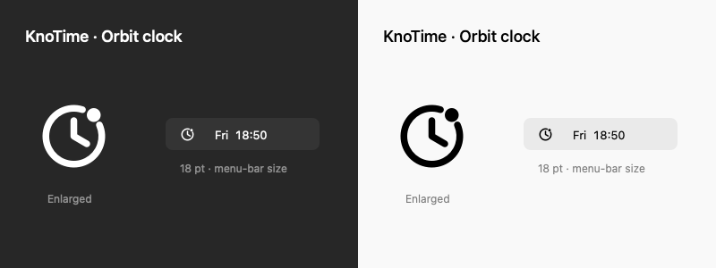

<div align="center">

# KnoTime
### Find time that works for everyone.
A native macOS menu-bar world clock with shared working hours.

[简体中文](README.zh-CN.md) · [Releases](https://github.com/ArB1t3r/KnoTime/releases) · [User guide](docs/usage.md) · [Contributing](CONTRIBUTING.md)



**Inspired by [Hovrly](https://hovrly.com/). Built independently with SwiftUI and AppKit.**

</div>

## Time zones, without the mental arithmetic

Keep your cities in the menu bar. Scrub the timeline to compare local times, then release to return to now. Turn on the briefcase for each participant: the pale green timeline fill shows when everyone's working hours overlap.

- **Native and lightweight.** One app process, no Electron runtime. Minute-aligned updates; hidden panels stop visual updates and breathing animations.
- **Find shared working time.** Set a local start/end time for each city, including overnight shifts. Enable one city to see its hours, or several to see only their intersection.
- **Glance, compare, return.** Horizontal scrolling, drag-to-preview, snap back to now, fixed time capsules and separate previous/next-day labels.
- **Daylight follows the city.** Sun/moon indicators use calculated solar position and city coordinates, including during previews.
- **Lives in the menu bar.** No Dock icon. Choose which cities appear there; collapse settings when you're done.
- **Clocks work offline.** No account or analytics. City search and time calculations stay on your Mac. Optional daily update checks contact GitHub.
- **Built-in updates.** Sparkle checks for signed updates, with manual checking and an automatic-check toggle. Installation asks for confirmation.

## Measured footprint

A short local comparison, with both panels hidden:

| Metric | KnoTime | Hovrly 2.4.5 |
|---|---:|---:|
| Processes | 1 | 4 |
| Mean summed RSS | 120.9 MiB | 390.7 MiB |
| Sampled CPU | 0.0% | 0.0% |

**About 69% less summed RSS in this sample.** Six samples, two seconds apart. Summed RSS can double-count shared memory; this is not a physical-footprint or battery-life benchmark. The sample predates Sparkle integration and final UI refinements, so it does not establish the current release's memory usage. Startup time and scrolling latency have not been benchmarked. See [method and limitations](docs/verification.md#performance-sample) and [raw samples](docs/performance-sample.json).

## Install

**Release status:** the first Developer ID–signed, Apple-notarized installer is being prepared. Until a signed release is published, this repository is available for building locally; no unsigned installer is presented as ready for general distribution.

Once available, download `KnoTime.dmg` from [Releases](https://github.com/ArB1t3r/KnoTime/releases), open it, and drag KnoTime into Applications. Launch it and look for the orbit-clock icon in the menu bar. No Terminal commands should be required for the notarized release.

Requires **macOS 14 or later**. Release builds target Apple Silicon and Intel; interactive QA is currently performed on Apple Silicon. Existing 1.0 builds need a one-time manual upgrade to gain the updater.

## Build

Install Xcode with Swift 6 or later, then:

```sh
git clone https://github.com/ArB1t3r/KnoTime.git
cd KnoTime
./build.sh --test
open dist/KnoTime.app
```

The first build downloads the pinned Sparkle dependency. Local builds are ad-hoc signed. For a universal binary, run `KNOTIME_UNIVERSAL=1 ./build.sh`. SwiftPM's native build engine is used for the verified local environment; it is deprecated in Swift 6.4.

See [release and signing instructions](docs/releasing.md), [architecture](docs/architecture.md), and [verification](docs/verification.md).

## Contribute

Bug reports, accessibility improvements, localization, and measured performance improvements are welcome. Please read [CONTRIBUTING.md](CONTRIBUTING.md). Report security concerns through [private vulnerability reporting](https://github.com/ArB1t3r/KnoTime/security/advisories/new), not public issues.

## Credits and license

KnoTime is **inspired by [Hovrly](https://hovrly.com/)**, particularly its compact menu-bar experience and time-scrubbing interaction. Thank you to the Hovrly team for the inspiration. This is an independent project, not an official Hovrly release or an affiliated product.

[MIT license](LICENSE). See [third-party notices](THIRD_PARTY_NOTICES.md) for Sparkle, IANA time-zone data, and solar methodology.
