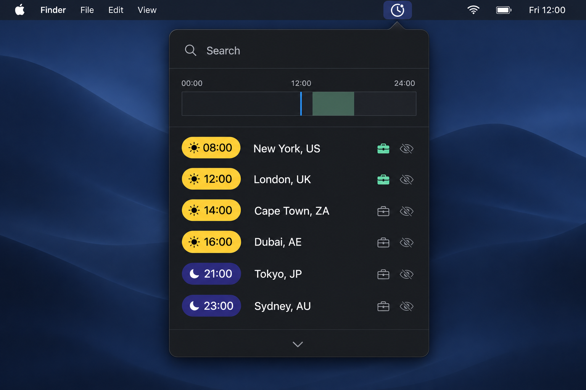
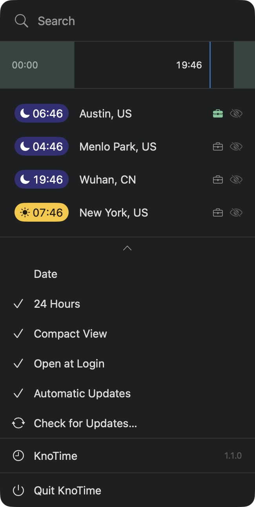

<div align="center">

# KnoTime
### 找到大家都有空的那段时间。
原生 macOS 菜单栏世界时钟，支持工作时间交集。

[下载 macOS 安装包](https://github.com/ArB1t3r/KnoTime/releases/latest/download/KnoTime.dmg) · [English](README.md) · [下载与发布](https://github.com/ArB1t3r/KnoTime/releases) · [参与贡献](CONTRIBUTING.md)



<sub>产品示意图 · 六座城市，同一条时间轴。</sub>

**Inspired by [Hovrly](https://hovrly.com/)。使用 SwiftUI 与 AppKit 独立实现。**

</div>

## 不只看时间，还能找到合适的时间

把常用城市留在菜单栏。横向滚动或拖动时间轴，对照各地时间；松开后回到现在。开启城市旁的公文包，淡绿色填充就会显示工作时间。开启多个城市时，只显示大家共同的工作时段。

- **原生、低占用**：单个应用进程，无 Electron 运行时。按分钟刷新，关闭面板后停止界面时间更新和呼吸动画。
- **工作时间对齐**：每个城市单独配置当地上下班时间，支持跨午夜班次；多个城市自动计算交集。
- **快速理解时差**：保留滚动预览、松手回到现在的交互；前一天、后一天提示独立显示，不挤动时间胶囊。
- **随真实日照变化**：根据城市坐标与日期计算太阳位置，预览时间也会同步变化。
- **常驻菜单栏**：无 Dock 图标，城市显示可选，设置可折叠。
- **离线时钟**：无需账号、不含分析追踪。城市搜索、时区和日照计算均在本地完成；可选的更新检查会连接 GitHub。
- **自动更新**：通过 Sparkle 检查签名更新包；支持手动检查和关闭自动检查，安装前征求用户确认。

<details>
<summary>查看设置与自动更新界面</summary>



</details>

## 已测出的轻量化优势

在两个应用面板均收起的短时采样中：

| 指标 | KnoTime | Hovrly 2.4.5 |
|---|---:|---:|
| 进程数 | 1 | 4 |
| 合计 RSS 均值 | 120.9 MiB | 390.7 MiB |
| 采样 CPU | 0.0% | 0.0% |

本次样本中合计 RSS **约低 69%**。共采样 6 次、间隔 2 秒；RSS 相加可能重复计算共享页面。这组数据采集于自动更新集成及最终 UI 调整之前，不代表当前发布版的精确占用，也不能推导省电比例。启动速度和滑动延迟尚未量化，因此不宣称“快几倍”。[完整记录与限制](docs/verification.md#performance-sample)。

## 安装

**KnoTime 1.1.0 已正式发布，完成 Developer ID 签名与 Apple 公证。**

[**下载 macOS 安装包**](https://github.com/ArB1t3r/KnoTime/releases/latest/download/KnoTime.dmg)

1. 打开 **KnoTime.dmg**。
2. 把 **KnoTime** 拖入 **Applications（应用程序）**。
3. 从应用程序启动 KnoTime，点击菜单栏中的时钟图标即可使用。

无需开发者账号、配置签名或执行终端命令。如果 macOS 首次启动时询问是否打开，点击 **打开** 即可。

要求 macOS 14 或更新版本。发布构建面向 Apple Silicon 和 Intel；目前交互测试在 Apple Silicon 完成。之前的 1.0 版本需要手动安装一次新版，之后即可使用内置更新。

<details>
<summary>开发者：从源码构建</summary>

安装 Xcode 与 Swift 6 或更新版本：

```sh
git clone https://github.com/ArB1t3r/KnoTime.git
cd KnoTime
./build.sh --test
open dist/KnoTime.app
```

首次构建会下载锁定版本的 Sparkle。通用架构构建：`KNOTIME_UNIVERSAL=1 ./build.sh`。

[使用说明](docs/usage.md) · [发布与签名](docs/releasing.md) · [架构](docs/architecture.md) · [贡献指南](CONTRIBUTING.md)

</details>

## 致谢与许可

明确致敬 **[Hovrly](https://hovrly.com/)** 的菜单栏布局与时间预览交互。KnoTime 是独立开发的原生实现，与 Hovrly 无隶属或官方合作关系，不包含其品牌资源或应用资产。

项目采用 [MIT](LICENSE) 许可证。[第三方声明](THIRD_PARTY_NOTICES.md) 包含 Sparkle、IANA 时区数据与太阳位置计算来源。
